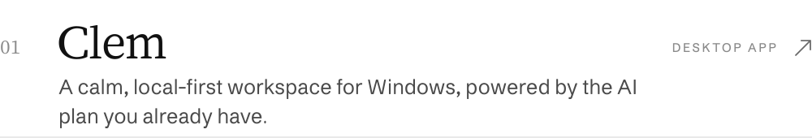
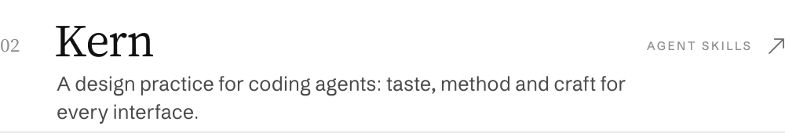

<picture><source media="(prefers-color-scheme: dark)" srcset="assets/hero-dark.svg"></picture>

<a href="https://mohamedmowafy.com"><picture><source media="(prefers-color-scheme: dark)" srcset="assets/website-dark.svg"></picture></a>

 

<picture><source media="(prefers-color-scheme: dark)" srcset="assets/section-dark.svg"></picture>

<a href="https://github.com/mowfxy/clem"><picture><source media="(prefers-color-scheme: dark)" srcset="assets/work-clem-dark.svg"></picture></a>
<a href="https://github.com/mowfxy/kern"><picture><source media="(prefers-color-scheme: dark)" srcset="assets/work-kern-dark.svg"></picture></a>
<a href="https://github.com/mowfxy/anti-slop"><picture><source media="(prefers-color-scheme: dark)" srcset="assets/work-anti-slop-dark.svg"></picture></a>
<a href="https://github.com/mowfxy/web-perf"><picture><source media="(prefers-color-scheme: dark)" srcset="assets/work-web-perf-dark.svg"></picture></a>
<a href="https://github.com/mowfxy/kinetra"><picture><source media="(prefers-color-scheme: dark)" srcset="assets/work-kinetra-dark.svg"></picture></a>

 

<picture><source media="(prefers-color-scheme: dark)" srcset="assets/footer-dark.svg"></picture>

<!-- Generated by scripts/build.py. Set in Mowafy Serif and Mowafy Sans. -->
