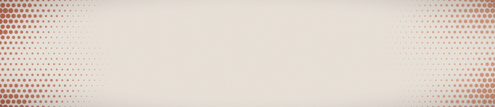

<picture>
  <source media="(prefers-color-scheme: dark)" srcset="assets/banner-dark.svg">
  
</picture>

# hey, I'm Mohamed

Electronics engineering student at the [German University in Cairo](https://www.guc.edu.eg), building tools that make AI agents do more careful work.

Right now that means **[Mowr](https://mowrai.com)**, a local-first AI workspace for Windows, and a set of open-source skills that teach coding agents design taste, finish quality and performance discipline.

---

## Mowr

A desktop AI workspace that keeps your chats and files on your own machine. Public preview builds for Windows x64 are on the [releases page](https://github.com/mowfxy/mowr-releases/releases).

## Agent skills

Drop-in skills for Codex that change *how* an agent builds, not just what it builds.

| | |
|:--|:--|
| **[Blend](https://github.com/mowfxy/blend)** | Eleven coordinated frontend skills: typography, art direction, interfaces, imagery, mascots, motion and review. One brief, one consistent identity. |
| **[anti-slop](https://github.com/mowfxy/anti-slop)** | Makes the agent finish the details before handing a site over: working forms, honest content, mobile layouts, accessibility, metadata, privacy checks. |
| **[Web Performance Optimizer](https://github.com/mowfxy/web-perf)** | Measure first, fix the real bottleneck, prevent regressions. Covers Core Web Vitals, caching, media and edge delivery. |
| **[Repo Tidier](https://github.com/mowfxy/cl-repo)** | Turns a messy repository into a clean, professional project without changing its behavior or touching work in progress. |

## Engineering

**[Kinetra](https://github.com/mowfxy/kinetra)** is a TypeScript workbench for physics diagrams, circuit and Boolean tools. It renders reviewed SVG diagrams of optics, forces, fields and circuits from plain JSON models.

## Toolbox

---

Cairo, Egypt · Arabic, English, German
