

  

  <a href="https://mohamedmowafy.com"></a>
  <a href="https://mowrai.com"></a>
  <a href="https://github.com/mowfxy/mowr-releases/releases"></a>

  

  <a href="https://github.com/mowfxy/mowr-releases"></a>
  <a href="https://github.com/mowfxy/blend"></a>
  <a href="https://github.com/mowfxy/anti-slop"></a>
  <a href="https://github.com/mowfxy/web-perf"></a>
  <a href="https://github.com/mowfxy/cl-repo"></a>
  <a href="https://github.com/mowfxy/kinetra"></a>

  

  

<!-- Assets are generated by scripts/build.py -->
