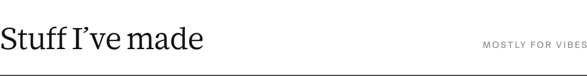
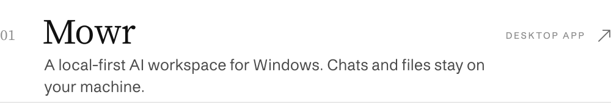
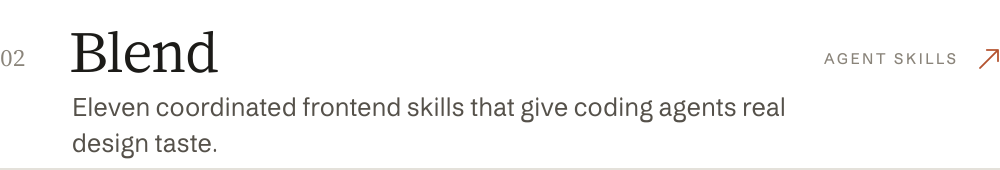
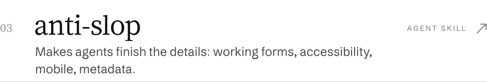
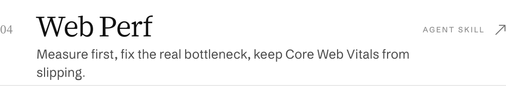
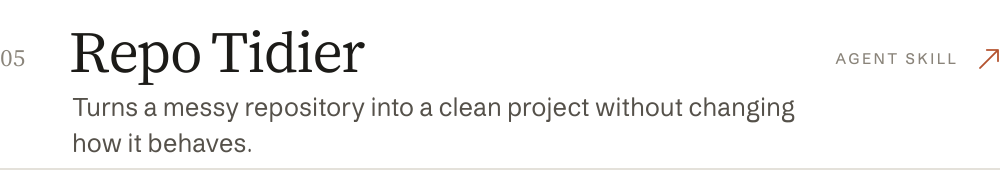
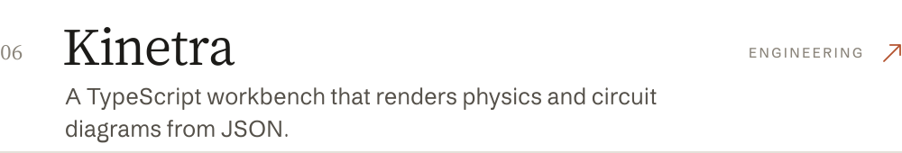

<picture><source media="(prefers-color-scheme: dark)" srcset="assets/hero-dark.svg"></picture>

  <a href="https://mohamedmowafy.com"><picture><source media="(prefers-color-scheme: dark)" srcset="assets/link-site-dark.svg"></picture></a>

 

<picture><source media="(prefers-color-scheme: dark)" srcset="assets/section-dark.svg"></picture>

<a href="https://github.com/mowfxy/mowr-releases"><picture><source media="(prefers-color-scheme: dark)" srcset="assets/work-mowr-dark.svg"></picture></a>
<a href="https://github.com/mowfxy/blend"><picture><source media="(prefers-color-scheme: dark)" srcset="assets/work-blend-dark.svg"></picture></a>
<a href="https://github.com/mowfxy/anti-slop"><picture><source media="(prefers-color-scheme: dark)" srcset="assets/work-anti-slop-dark.svg"></picture></a>
<a href="https://github.com/mowfxy/web-perf"><picture><source media="(prefers-color-scheme: dark)" srcset="assets/work-web-perf-dark.svg"></picture></a>
<a href="https://github.com/mowfxy/cl-repo"><picture><source media="(prefers-color-scheme: dark)" srcset="assets/work-repo-tidier-dark.svg"></picture></a>
<a href="https://github.com/mowfxy/kinetra"><picture><source media="(prefers-color-scheme: dark)" srcset="assets/work-kinetra-dark.svg"></picture></a>

 

<picture><source media="(prefers-color-scheme: dark)" srcset="assets/footer-dark.svg"></picture>

<!-- Generated by scripts/build.py. Set in Mowafy Serif and Mowafy Sans. -->
