<a href="https://mohamedmowafy.com">mohamedmowafy.com</a> &nbsp;·&nbsp; <a href="https://github.com/mowfxy?tab=repositories">all repositories</a>

<!-- Generated by scripts/build.py. Set in JetBrains Mono (OFL). -->
